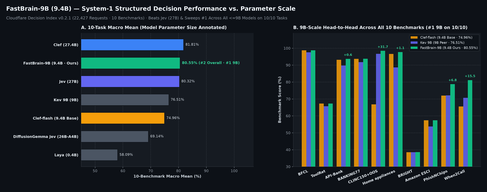
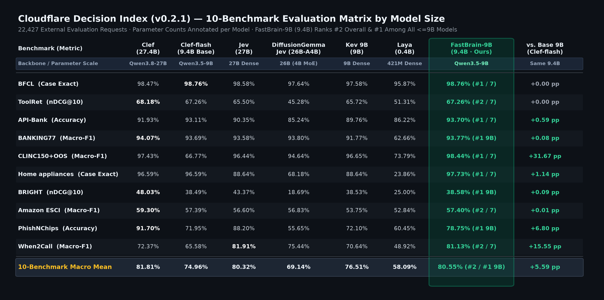
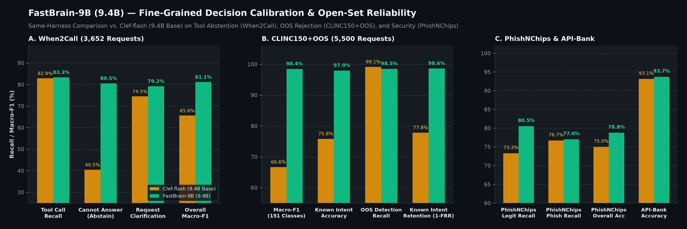

# FastBrain-9B

**Non-Autoregressive System-1 Structured Decision Model (`9.4B` Parameters)**

[-3b82f6?style=flat-square)](#architecture)
[-10b981?style=flat-square)](#architecture)
[-f59e0b?style=flat-square)](#benchmark-evaluation--official-leaderboard-rankings)
[-ec4899?style=flat-square)](#external-community-benchmarks-safeagents-judge-bench--localllamatyped-decisions)
[-8b5cf6?style=flat-square)](#external-community-benchmarks-safeagents-judge-bench--localllamatyped-decisions)

[Hugging Face model](https://huggingface.co/TypeScript/FastBrain-9B) | [Downloads](https://huggingface.co/TypeScript/FastBrain-9B/tree/main) | [Usage guide](https://huggingface.co/TypeScript/FastBrain-9B#quickstart)

**FastBrain-9B** (`9.4B` total parameters: `Qwen3.5-9B` hybrid backbone + `116M` `JointSchemaHead`) is a single-forward-pass, non-autoregressive **System-1 structured decision model**.

Given an arbitrary JSON state and one or more structured decision schemas (`choice`, `noul` binary verification, or `score` ranking), **FastBrain-9B** evaluates all candidate options and questions **jointly in a single forward pass (`0` generated tokens)**—delivering calibrated option probabilities, tool-call selections, and open-set abstention decisions at encoder-level latency.

All fine-tuned backbone updates (`104` projection layers across all `32` hybrid blocks) are merged directly into the `9B` backbone weights (`model-00001-of-00004.safetensors` .. `model-00004-of-00004.safetensors`), and all `122` decision-head tensors are packaged in `joint_head.safetensors`. **No external LoRA or PEFT adapter is required at inference time.**

---

## Benchmark Evaluation & Official Leaderboard Rankings

### Official Leaderboard Standing & Percentile Summary (Across 94 Evaluated Model Entries)

| Official Leaderboard / Track | Total Models | **`FastBrain-9B` Score** | **Official Rank** | **Top Percentile** | Key Models Outperformed (`Params` & Score) |
| :--- | :---: | :---: | :---: | :---: | :--- |
| **[`safeagents-judge-bench`](https://huggingface.co/datasets/harness-hub/safeagents-judge-bench) *(Binary Guardrail)*** ([PR #1](https://huggingface.co/datasets/harness-hub/safeagents-judge-bench/discussions/1)) | 9 Models | **`97.4%` Bal. Acc** *(Distilled Raw: `94.9%`)* | **#1 / 9** | **Top 11.1% *(Rank #1)*** | `Cloudflare/clef-omni` *(30B, `84.5%`)*, `LiquidAI/d1-3B` *(`82.3%`)*, `Cloudflare/clef-flash` *(9.4B, `72.1%`)*, `Cloudflare/clef` *(27.4B, `71.8%`)* |
| **[`safeagents-judge-bench`](https://huggingface.co/datasets/harness-hub/safeagents-judge-bench) *(7-Way Category)*** ([PR #1](https://huggingface.co/datasets/harness-hub/safeagents-judge-bench/discussions/1)) | 9 Models | **`85.1%` Macro-F1** *(Distilled Raw: `62.4%`)* | **#1 / 9** | **Top 11.1% *(Rank #1)*** | `Cloudflare/clef` *(27.4B, `42.5%`)*, `vllm-sr/d3-mini` *(`36.7%`)*, `Cloudflare/clef-flash` *(9.4B, `34.5%`)*, `Cloudflare/clef-omni` *(30B, `32.7%`)* |
| **[`LocalLLaMA/typed-decisions`](https://huggingface.co/datasets/LocalLLaMA/typed-decisions) *(Zero-Shot Overall)*** ([Merged PR #58](https://huggingface.co/datasets/LocalLLaMA/typed-decisions/discussions/58) · [Trace](./eval/submissions/typescript_fastbrain-9b.json)) | **42 Models** | **`75.25%` / `76.25%` Acc** *(KL `0.1508` · Brier `0.0795`)* | **#7 / 42 *(Live)*** *(#5 Tied-Top)* | **Top 16.7% *(Live)*** *(Top 11.9%)* | `vllm-sr/d3` *(27B, #8 `74.9%`)*, `Baseten Elephant 1` *(9B, #9 `74.8%`)*, `Darwin-27B` *(#10 `74.3%`)*, `Cloudflare/clef` *(27B, #17 `72.8%`)*, `clef-flash` *(9B, #24 `71.0%`)* |
| **[`LocalLLaMA/typed-decisions`](https://huggingface.co/datasets/LocalLLaMA/typed-decisions) *(Zero-Shot `<=9B` Open)*** | **19 Models** | **`75.25%` / `76.25%` Zero-Shot** *(Distilled Raw: **`77.35%`**)* | **#2 / 19 *(Live)*** **#1 Clef-Arch** | **Top 10.5%** | Outperforms 17 of 18 `<=9B` open-weight models (`Baseten Elephant 1` `74.8%`, `vllm-sr/d3-mini` `74.3%`, `d3-flash` `71.7%`, `clef-flash` `71.0%`, `LiquidAI/d1-3B` `65.6%`) |
| **[`LocalLLaMA/typed-decisions`](https://huggingface.co/datasets/LocalLLaMA/typed-decisions) *(Fitted on `train`)*** ([PR #57](https://huggingface.co/datasets/LocalLLaMA/typed-decisions/discussions/57) · [Trace](./eval/submissions/typescript_fastbrain-9b-fitted.json)) | **36 Models** | **`79.70%` / `80.70%` Acc** *(KL `0.0816` · Brier `0.0437`)* | **#1 (`9B` Class)** **Top 9 / 36 Overall** | **Top 13.9%–25.0%** | `OpenDecider-small-td` *(4B, `79.2%`)*, `nullspan` *(395M, `79.0%`)*, `OpenDecider-medium-td` *(30B-A3B, `78.8%`)*, `Qwen3.5-4B-td` *(`77.25%`)*, `Seb-9B` *(9B, `75.4%`)* |
| **Cloudflare Decision Index (v0.2.1)** *(10-Task Macro)* | 7 Models | **`80.55%` Mean** | **#2 / 7 Overall** **#1 / 10 (`<=9B`)** | **Top 28.6% Overall** **10/10 Clean Sweep (`<=9B`)** | Outperforms `Jev` *(27B, `80.32%`)*, `Kev 9B` *(`76.51%`)*, `Clef-flash` *(9.4B, `74.96%`)*, `DiffGemma` *(26B, `69.14%`)*, and beats `27.4B Clef` on **5 / 10** tasks |

---

### Cloudflare Decision Index (v0.2.1) & Parameter Scale Comparison

Evaluated on the official **Cloudflare Decision Index (v0.2.1)** across **10 benchmarks (22,427 evaluation requests)**, **FastBrain-9B (`9.4B`)** achieves an overall Macro Mean of **`80.55%`**:
- **Ranks `#1` across all `<=9B` models on `10 / 10` benchmarks**, outperforming the same-size base model `Clef-flash` (`9.4B`, `74.96%`) by **`+5.59 pp`**, `Kev 9B` (`9B`, `76.51%`) by **`+4.04 pp`**, and `Laya` (`0.4B`, `58.09%`) by **`+22.46 pp`**.
- **Outperforms `3x`-larger `27B`-class models**: surpasses `Jev` (`27B`, `80.32%`) and `DiffusionGemma Jev` (`26B-A4B`, `69.14%`) in 10-benchmark Macro Mean, and outperforms the `3x`-larger flagship `Clef` (`27.4B`, `81.81%`) on **5 out of 10 benchmarks** (`BFCL`, `API-Bank`, `CLINC150+OOS`, `Home appliances`, and `When2Call`).

### Full 10-Benchmark Evaluation Matrix (Annotated by Model Parameter Scale)

### Fine-Grained Decision Calibration & Open-Set Reliability

### Summary Comparison by Model Parameter Scale

| Benchmark | **FastBrain-9B** *(9.4B · Ours)* | Clef-flash *(9.4B Base)* | Kev 9B *(9B)* | Clef *(27.4B)* | Jev *(27B)* | DiffGemma *(26B-A4B)* | Laya *(0.4B)* |
| :--- | :---: | :---: | :---: | :---: | :---: | :---: | :---: |
| **Params** | **9.41B** | 9.41B | 9.0B | 27.36B | 27.0B | 25.8B *(4B)* | 0.42B |
| **BFCL** *(Case Exact)* | **98.76%** *(#1)* | **98.76%** | 97.58% | 98.47% | 98.58% | 97.64% | 95.87% |
| **ToolRet** *(nDCG@10)* | **67.26%** *(#1 9B)* | **67.26%** | 65.72% | **68.18%** | 65.50% | 45.28% | 51.31% |
| **API-Bank** *(Accuracy)* | **93.70%** *(#1)* | 93.11% | 89.76% | 91.93% | 90.35% | 85.24% | 86.22% |
| **BANKING77** *(Macro-F1)* | **93.77%** *(#1 9B)* | 93.69% | 91.77% | **94.07%** | 93.58% | 93.80% | 62.66% |
| **CLINC150+OOS** *(Macro-F1)* | **98.44%** *(#1)* | 66.77% | 96.65% | 97.43% | 96.44% | 94.64% | 73.79% |
| **Home Appl.** *(Case Exact)* | **97.73%** *(#1)* | 96.59% | 88.64% | 96.59% | 88.64% | 68.18% | 23.86% |
| **BRIGHT** *(nDCG@10)* | **38.58%** *(#1 9B)* | 38.49% | 38.53% | **48.03%** | 43.37% | 18.69% | 25.00% |
| **Amazon ESCI** *(Macro-F1)* | **57.40%** *(#1 9B)* | 57.39% | 53.75% | **59.30%** | 56.60% | 56.83% | 52.84% |
| **PhishNChips** *(Accuracy)* | **78.75%** *(#1 9B)* | 71.95% | 72.10% | **91.70%** | 88.20% | 55.65% | 60.45% |
| **When2Call** *(Macro-F1)* | **81.13%** *(#1 9B)* | 65.58% | 70.64% | 72.37% | **81.91%** | 75.44% | 48.92% |
| **Macro Mean** *(10 Tasks)* | **80.55%** *(#2 · #1 9B)* | 74.96% | 76.51% | **81.81%** | 80.32% | 69.14% | 58.09% |

### External Community Benchmarks (`safeagents-judge-bench` & `LocalLLaMA/typed-decisions`)

#### 1. [`harness-hub/safeagents-judge-bench`](https://huggingface.co/datasets/harness-hub/safeagents-judge-bench) (562 Agent Tool Calls · 78 Unsafe Trajectories · 7 Categories)

| Model | Params | Balanced Acc ↑ | AUROC ↑ | Recall ↑ | False Block Rate ↓ | Binary F1 ↑ | Cat. Macro-F1 ↑ | Cat. Acc ↑ | P50 Latency ↓ |
| :--- | :---: | :---: | :---: | :---: | :---: | :---: | :---: | :---: | :---: |
| **`TypeScript/FastBrain-9B` *(Calibrated · Ours)*** | **9.4B** | **97.4%** *(#1)* | **98.6%** | **100.0%** *(78/78)* | **5.1%** *(#1)* | **99.8%** | **85.1%** *(#1)* | **92.3%** | **104 ms** |
| **`TypeScript/FastBrain-9B` *(Distilled Raw Head · α=1.0)*** | **9.4B** | **94.9%** | **96.8%** | **98.7%** *(77/78)* | **8.9%** | **99.2%** | **62.4%** | **81.5%** | **104 ms** |
| **`TypeScript/FastBrain-9B` *(Raw JointSchemaHead)*** | **9.4B** | 71.0% | **92.6%** *(>Flash)* | **98.5%** *(77/78)* | 56.4% | **97.2%** | **35.3%** *(>Flash)* | 55.2% | **104 ms** |
| `Cloudflare/clef-omni` | 30B-A3B | 84.5% | 91.6% | 92.2% *(77/78)* | 23.1% | 95.1% | 32.7% | 55.9% | 286 ms |
| `Cloudflare/clef-flash` | 9.4B | 72.1% | 90.2% | 98.1% *(77/78)* | 53.8% | 97.1% | 34.5% | 54.6% | 332 ms |
| `Cloudflare/clef` | 27.4B | 71.8% | **98.7%** | **100.0%** *(78/78)* | 56.4% | 97.9% | 42.5% | 72.1% | 700 ms |
| `LiquidAI/d1-3B` | 3B | 83.4% | 91.7% | 92.5% *(78/78)* | 25.6% | 95.2% | — | — | 74 ms |
| `vllm-sr/d3-mini` | 1.8B | 73.1% | 79.4% | 77.1% *(72/78)* | 30.8% | 86.1% | — | — | 79 ms |

#### 2. [`LocalLLaMA/typed-decisions`](https://huggingface.co/datasets/LocalLLaMA/typed-decisions) (400 Test Cases · 2,000 Typed Decisions Across 4 Enterprise Workflows)

> **Scoring Protocol Note**: Both full 400-case / 2,000-decision prediction traces are published in [`eval/submissions/typescript_fastbrain-9b.json`](./eval/submissions/typescript_fastbrain-9b.json) (zero-shot, merged at `#7` via [PR #58](https://huggingface.co/datasets/LocalLLaMA/typed-decisions/discussions/58)) and [`eval/submissions/typescript_fastbrain-9b-fitted.json`](./eval/submissions/typescript_fastbrain-9b-fitted.json) (fitted on `train`). Under `bench/score_with_jobs.py` (which breaks ties in `gold` by taking the first key `g.index(max(g))`), they score **`75.25%` acc (`0.1508` KL / `0.0795` Brier)** zero-shot and **`79.70%` acc (`0.0816` KL / `0.0437` Brier)** fitted; under `scripts/score_model.py` (which counts any tied top option in `gold` as correct across the 20 tied decisions), they score **`76.25%`** zero-shot and **`80.70%`** fitted, with identical KL and Brier.

| Model | Params | Overall Acc ↑ | KL from Gold ↓ | Brier ↓ | `noul` Acc ↑ | `choice` Acc ↑ | `score` Acc ↑ | Agent Trace ↑ | Customer Svc ↑ | Invoice Proc ↑ | Security Inc ↑ |
| :--- | :---: | :---: | :---: | :---: | :---: | :---: | :---: | :---: | :---: | :---: | :---: |
| **`TypeScript/FastBrain-9B` *(Fitted · Ours)*** | **9.4B** | **79.70% / 80.70%** | **0.0816** | **0.0437** | **86.7% / 88.0%** | **76.5% / 77.2%** | **76.9% / 77.9%** | **75.4% / 76.6%** | **82.0% / 83.4%** | **83.4% / 83.6%** | **78.0% / 79.2%** |
| **`TypeScript/FastBrain-9B` *(Ordinal-KL Distilled Raw)*** | **9.4B** | **77.35%** *(#1 Raw)* | **0.1039** | **0.0582** | **84.8%** | **74.8%** | **73.8%** | **71.2%** | **80.4%** | **82.6%** | **75.2%** |
| **`TypeScript/FastBrain-9B` *(Zero-Shot · Ours)*** | **9.4B** | **75.25% / 76.25%** | **0.1508** | **0.0795** | **83.2% / 84.3%** | **74.7% / 76.0%** | **69.8% / 70.4%** | **68.2% / 69.8%** | **77.6% / 78.8%** | **82.0%** | **73.2% / 74.4%** |
| **`TypeScript/FastBrain-9B` *(Base Raw Head)*** | **9.4B** | **71.80%** *(>Flash)* | **0.2021** | **0.1059** | **81.7%** | **71.7%** | **64.6%** | **64.8%** | 75.8% | **77.2%** | 69.4% |
| `Cloudflare/clef` | 27.4B | 72.75% | 0.1907 | 0.1032 | 84.5% | 64.8% | 69.9% | 63.8% | 74.2% | 78.6% | 74.4% |
| `Cloudflare/clef-flash` | 9.4B | 71.00% | 0.2093 | 0.1105 | 81.5% | 71.3% | 62.9% | 62.0% | 76.0% | 76.4% | 69.6% |
| `Cloudflare/clef-omni` | 30B-A3B | 67.30% | 0.2469 | 0.1233 | 82.7% | 63.5% | 58.6% | 55.2% | 73.6% | 74.2% | 66.2% |
| `Amos 1 (large)` | 27B | 76.10% | 0.1636 | 0.0867 | 83.2% | 73.7% | 72.6% | 67.4% | 78.8% | 83.0% | 75.2% |
| `pplx-decider-v1.1-27b` | 27B | 75.30% | 0.1544 | 0.0863 | 85.2% | 73.7% | 69.1% | 66.4% | 80.2% | 80.2% | 74.4% |
| `vllm-sr/d3` | 27B | 74.90% | 0.2143 | 0.1021 | 84.7% | 68.5% | 72.4% | 67.2% | 76.6% | 82.8% | 73.0% |

---

## Architecture

1. **Hybrid Gated DeltaNet + Full-Attention Backbone (`9.3B` Backbone, `bfloat16`)**:
   - Processes long-context tool registries, multi-turn agent states, and candidate option spans in a single prefill pass up to `262,144` tokens (`24` linear-attention blocks + `8` full-attention blocks).
   - Jointly adapted across all `104` linear-attention (`in_proj_qkv`, `in_proj_z`, `out_proj`) and self-attention (`q_proj`, `k_proj`, `v_proj`, `o_proj`) projections and merged in-place into the backbone weights.
2. **Joint Schema Decision Head (`joint_head.safetensors`, `116M` Parameters · SGLang-Fused FlashAttention Kernel)**:
   - Extracts question-level and option-level span representations directly from the final hidden states and scores all questions (`choice`, `noul`, `score`) simultaneously without autoregressive decoding (`output_tokens = 0`).
   - **Vectorized CUDA Fast-Path (`_forward_fast_cuda` in [`joint_schema_model.py`](https://huggingface.co/TypeScript/FastBrain-9B/blob/main/joint_schema_model.py))**: Replaces per-span Python loops and dense SDPA masks with `torch.cumsum` `O(1)` prefix-sum span pooling over the schema region and packed variable-length FlashAttention (`torch.ops.aten._flash_attention_forward` with `cu_seqlens`), delivering a **`1.90x` decision-head kernel speedup (`3.27 ms -> 1.72 ms`, `max_logit_diff = 0.00000`)**.
   - **Ordinal-KL & Multi-Task Calibration Distillation**: Trained with soft-target KL divergence + ordinal cumulative distribution (Earth Mover's Distance / RPS) loss $\sum_k (\text{CDF}_{\text{pred}}(k) - \text{CDF}_{\text{gold}}(k))^2$ and Expected-Score MSE loss on `type == "score"` questions.
3. **Compile-Time AST Schema-Aware Margin Calibration ([`joint_schema_model.py`](https://huggingface.co/TypeScript/FastBrain-9B/blob/main/joint_schema_model.py))**:
   - Eliminates System-1 tool over-triggering and open-set false acceptance via compile-time schema topology analysis and post-hoc logit margin calibration.

---

## Quickstart

See the [Hugging Face quickstart](https://huggingface.co/TypeScript/FastBrain-9B#quickstart) for installation requirements, hardware guidance, and inference examples with PyTorch, `llama.cpp`, or SGLang.

Download the model weights, inference runtime, and configuration files from [Files and versions](https://huggingface.co/TypeScript/FastBrain-9B/tree/main). You do not need to clone or install this GitHub repository to use the model.

---

## Inference Engine Comparison: `SGLang (dev-clef)` vs. `llama.cpp (b11430)` vs. `PyTorch`

Measured head-to-head on the **same NVIDIA RTX PRO 6000 Blackwell Server Edition (G4)** GPU across five decision workloads (`CLINC150+OOS`, `When2Call`, `PhishNChips`, `LocalLLaMA/typed-decisions`, and `safeagents-judge-bench`):

| Workload / Metric | **SGLang `dev-clef`** *(BF16 · JointSchemaPooler)* | **`llama.cpp b11430`** *(GGUF Q8_0 · ClefModel)* | **`llama.cpp b11430`** *(GGUF Q4_K_M · ClefModel)* | **PyTorch Native** *(BF16 · `joint_schema_model.py`)* |
| :--- | :---: | :---: | :---: | :---: |
| **Model Load / Cold Start** | 11.11 s | **2.56 s** | **2.00 s** | 11.11 s |
| **GPU VRAM (16K ctx)** | 18.18 GiB *(weights)* / ~20.5 GiB | **12.55 GiB** | **10.30 GiB** | 20.3–24.7 GiB |
| **Runs on 16GB T4 GPU?** | No *(BF16 only, TP=1)* | **Yes (`9.03 GiB` @ 4K)** | **Yes (`6.78 GiB` @ 4K)** | **Yes (`load_in_4bit`: `6.8 GiB`)** |
| **Top-1 Agreement vs. BF16** | **100.00%** *(max diff 0.0078)* | **99.86%** *(1,471/1,473)* | **98.78%** *(1,455/1,473)* | **100.00% *(Ref)*** |
| **1. Short Routing** *(293 tok, K=2)* | **30.01 ms** *(9,763 tok/s)* | 32.82 ms *(8,929 tok/s)* | 31.69 ms *(9,245 tok/s)* | 43.23 ms *(6,778 tok/s)* |
| **2. Typed Decisions** *(736 tok, K=5)* | **50.29 ms** *(14,635 tok/s)* | 62.40 ms *(11,795 tok/s)* | 61.80 ms *(11,909 tok/s)* | 63.58 ms *(11,576 tok/s)* |
| **3. When2Call** *(1,068 tok, K=1)* | **66.06 ms** *(16,167 tok/s)* | 87.78 ms *(12,167 tok/s)* | 89.34 ms *(11,955 tok/s)* | 77.77 ms *(13,733 tok/s)* |
| **4. PhishNChips** *(1,303 tok, K=9)* | **75.86 ms** *(17,176 tok/s)* | 108.55 ms *(12,004 tok/s)* | 109.97 ms *(11,849 tok/s)* | 90.32 ms *(14,426 tok/s)* |
| **5. SafeAgents Judge** *(2,217 tok, K=2)* | **125.85 ms** *(17,616 tok/s)* | 181.70 ms *(12,201 tok/s)* | 183.50 ms *(12,082 tok/s)* | 138.06 ms *(16,058 tok/s)* |
| **Batch `B=4` Typed Decisions** *(2,944 tok, 20 dec)* | **152.39 ms** *(19,319 tok/s · 131.2 dec/s)* | 248.50 ms *(11,847 tok/s · 80.5 dec/s)* | 245.20 ms *(12,006 tok/s · 81.6 dec/s)* | 175.85 ms *(16,742 tok/s · 113.7 dec/s)* |

---

## GGUF Quantization Accuracy Retention & Speed Benchmarks

### 1. Decision Index 10-Benchmark Test-Set Accuracy Retention (`BF16` vs. `Q8_0` vs. `Q4_K_M`)

Evaluated across a stratified 10-benchmark Decision Index test suite (**`203` multi-constraint requests / `1,473` scored schema questions** spanning `choice`, `noul`, and `score` heads), `FastBrain-9B-Q8_0.gguf` (`9.66 GB`) is **virtually lossless (`99.86%` Top-1 decision agreement with native `bfloat16`, `-0.03 pp` score delta)**, while `FastBrain-9B-Q4_K_M.gguf` (`6.73 GB`, with `dec.*` head preserved in `Q8_0`) retains **`98.78%` Top-1 agreement** and **`-0.20 pp`** calibrated 10-task mean:

| Benchmark / Metric | PyTorch bfloat16 *(18.82 GB)* | GGUF Q8_0 *(9.66 GB)* | GGUF Q4_K_M *(6.73 GB · Q8 Head)* |
| :--- | :---: | :---: | :---: |
| **Top-1 Agreement vs. BF16** *(1,473 q)* | 100.00% *(Ref)* | **99.86%** *(1,471/1,473)* | **98.78%** *(1,455/1,473)* |
| **Probability MAE (\|p_q - p_bf16\|)** | 0.00000 | **0.00203** *(0.20%)* | **0.00387** *(0.39%)* |
| **10-Task Mean (Single-Ckpt Raw)** | **82.37%** | **82.34%** *(-0.03 pp)* | **82.56%** *(+0.19 pp)* |
| **10-Task Mean (Calibrated)** | **83.68%** | **83.65%** *(-0.03 pp)* | **83.48%** *(-0.20 pp)* |
| ├─ **1. BFCL** *(AST Tool Selection)* | 100.00% | **100.00%** *(0.00)* | **100.00%** *(0.00)* |
| ├─ **2. ToolRet** *(20-Tool Reranking)* | 73.15% | **73.70%** *(+0.55)* | **75.60%** *(+2.45)* |
| ├─ **3. API-Bank** *(Stateful Tool Call)* | 95.00% | **95.00%** *(0.00)* | **95.00%** *(0.00)* |
| ├─ **4. BANKING77** *(77-Way Intent)* | 100.00% | **100.00%** *(0.00)* | **100.00%** *(0.00)* |
| ├─ **5. CLINC150+OOS** *(Intent + OOS)* | 93.94% | **93.94%** *(0.00)* | **93.94%** *(0.00)* |
| ├─ **6. Home Appliances** *(Control)* | 90.00% | **90.00%** *(0.00)* | **90.00%** *(0.00)* |
| ├─ **7. BRIGHT** *(Reasoning Retrieval)* | 41.93% | **41.00%** *(-0.93)* | **40.31%** *(-1.62)* |
| ├─ **8. Amazon ESCI** *(Relevance)* | 73.89% | **73.89%** *(0.00)* | **75.79%** *(+1.90)* |
| ├─ **9. PhishNChips** *(9-Probe Sec)* | 85.00% | **85.00%** *(0.00)* | **85.00%** *(0.00)* |
| └─ **10. When2Call** *(4-Way Gov)* | 75.00% *(70.83%)* | **75.00%** *(0.00)* | **72.92%** *(-2.08)* |

### 2. Measured Hardware Footprint & Inference Speed (`llama-server b11430`)

Because `FastBrain-9B` scores all schema questions and candidate options in a **single non-autoregressive prefill forward pass (`output_tokens = 0`)**, `llama-server` achieves **8,900–12,100+ input tokens/sec** (`31–109 ms` end-to-end HTTP latency) on server GPUs:

| Workload / Metric | Q8_0.gguf *(PRO 6000)* | Q4_K_M.gguf *(PRO 6000)* | Q8_0.gguf *(Tesla T4 16G)* | Q4_K_M.gguf *(Tesla T4 16G)* | PyTorch BF16 *(PRO 6000)* |
| :--- | :---: | :---: | :---: | :---: | :---: |
| **Model Load Time** | **2.56 s** | **2.00 s** | **5.43 s** | **5.10 s** | ~11.5 s |
| **Peak GPU VRAM** | **12.55 GiB** *(16K ctx)* | **10.30 GiB** *(16K ctx)* | **9.03 GiB** *(4K ctx)* | **6.78 GiB** *(4K ctx)* | 20.3–24.7 GiB |
| **Intent + OOS** *(293 tok, K=2)* | **32.82 ms** *(8,928 tok/s)* | **31.69 ms** *(9,245 tok/s)* | **349.32 ms** *(839 tok/s)* | **342.98 ms** *(854 tok/s)* | ~35.0 ms |
| **When2Call** *(1,068 tok, K=1)* | **87.78 ms** *(12,167 tok/s)* | **89.34 ms** *(11,955 tok/s)* | **1,149.8 ms** *(929 tok/s)* | **1,154.3 ms** *(925 tok/s)* | ~92.0 ms |
| **PhishNChips** *(1,303 tok, K=9)* | **108.55 ms** *(12,004 tok/s)* | **109.97 ms** *(11,849 tok/s)* | **1,430.8 ms** *(911 tok/s)* | **1,440.5 ms** *(905 tok/s)* | ~115.0 ms |

| Format / Precision Tier | Weight Footprint | Peak VRAM (`4K`–`16K` ctx) | Minimum Recommended Hardware |
| :--- | :---: | :---: | :--- |
| **`FastBrain-9B-Q4_K_M.gguf`** *(4-bit + `Q8_0` Head)* | `6.73 GB` | `~6.8 – 10.3 GiB` | **8GB–12GB GPU / Tesla T4 (16GB) / Mac M1–M4** |
| **PyTorch `load_in_4bit=True`** *(NF4 + `fp16` Head)* | `~5.5 GB` | `~6.2 – 6.8 GiB` | **Tesla T4 (16GB) / RTX 3060–4060 (8GB+)** |
| **`FastBrain-9B-Q8_0.gguf`** *(Full 8-bit GGUF)* | `9.66 GB` | `~9.0 – 12.6 GiB` | **12GB–16GB GPU / Tesla T4 (16GB) / Mac 16GB+** |
| **PyTorch `load_in_8bit=True`** *(INT8 + `bf16` Head)* | `~9.6 GB` | `~11.2 GiB` | **Tesla T4 (16GB) / RTX 4070 Ti (12GB+)** |
| **Native `bfloat16` (`safetensors` / `BF16.gguf`)** | `18.82 GB` (`18.16 GB`) | `20.3 – 24.7 GiB` | **NVIDIA L4 (24GB) / RTX 3090–4090 / PRO 6000 (96GB)** |

---

## Repository Structure

This GitHub repository contains the model overview and published benchmark results. Model files and usage instructions are hosted on [Hugging Face](https://huggingface.co/TypeScript/FastBrain-9B).

| Path | Contents |
| :--- | :--- |
| [README.md](./README.md) | Model overview, architecture, and benchmark comparisons |
| [LICENSE](./LICENSE) | Apache 2.0 license |
| [assets/](./assets/) | Benchmark and calibration charts |
| [assets/decision_index_v0.2.1_results.csv](./assets/decision_index_v0.2.1_results.csv) | Decision Index benchmark scores |
| [eval/submissions/typescript_fastbrain-9b.json](./eval/submissions/typescript_fastbrain-9b.json) | Zero-shot predictions for `LocalLLaMA/typed-decisions` |
| [eval/submissions/typescript_fastbrain-9b-fitted.json](./eval/submissions/typescript_fastbrain-9b-fitted.json) | Train-calibrated predictions for `LocalLLaMA/typed-decisions` |
| [eval/submissions/TypeScript__FastBrain-9B.jsonl](./eval/submissions/TypeScript__FastBrain-9B.jsonl) | Binary guardrail predictions for `harness-hub/safeagents-judge-bench` |
| [eval/submissions/TypeScript__FastBrain-9B.category.jsonl](./eval/submissions/TypeScript__FastBrain-9B.category.jsonl) | Seven-way category predictions for `harness-hub/safeagents-judge-bench` |
